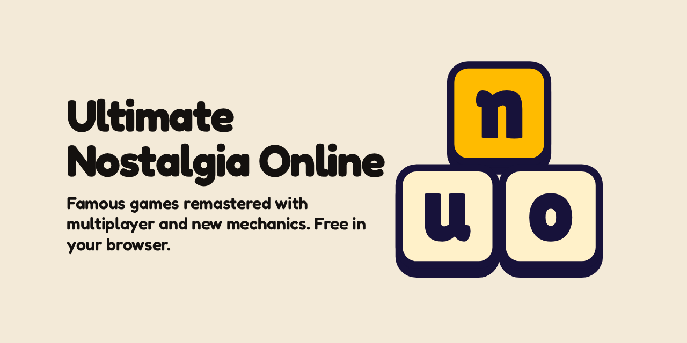

  

  
  

**uno** (Ultimate Nostalgia Online) is a hub of famous games remastered with multiplayer and new mechanics, free to play with your friends in the browser.

## Games

| Game        | Description                                                                                                     | Status      | Link                                           |
| ----------- | --------------------------------------------------------------------------------------------------------------- | ----------- | ---------------------------------------------- |
| Zerod       | A free card game for up to 12 friends. Open a room, send the code and play in the browser.                      | Out now     | [zerod.guilherr.me](https://zerod.guilherr.me) |
| Hero's Play | A rock rhythm game in the browser. Play the songs, climb the leaderboards and face your friends in multiplayer. | Out now     | [herosplay.online](https://herosplay.online/)  |
| Pebo        | Online 3D foosball. Teams of 1, 2 or 4 players, with just a nickname.                                           | Coming soon | None yet                                       |
| Ogro Party  | Nine minigames in the mud. Up to 8 players, online, in the browser.                                             | Coming soon | None yet                                       |

## What you get

|                         |                                                                                                            |
| ----------------------- | ---------------------------------------------------------------------------------------------------------- |
| One page, two languages | `/` in English and `/pt-br/` in Portuguese, plain static HTML                                              |
| SEO and GEO built in    | canonical, `hreflang`, Open Graph, JSON-LD, sitemap, `robots.txt`, `llms.txt`, tested over the built files |
| Tailwind, no framework  | responsive from 320 px to 1920 px, the text is never built by a script                                     |

## Development

    nvm use            # Node 22
    pnpm install
    pnpm dev           # builds, serves dist/ on :4173 and rebuilds on change
    pnpm check         # format, lint, build, unit tests and e2e

Playwright needs a browser once: `pnpm exec playwright install chromium`.

## Deploys

Every push to `main` is published to GitHub Pages by `.github/workflows/deploy.yml`. One-time setup (Pages source, DNS, HTTPS) is in [`docs/deploying.md`](docs/deploying.md).

## FAQ

<b>Are the games free?</b>

Yes. They run in the browser, with no install.

<b>Do I need an account to play?</b>

No. The hub has no accounts and stores nothing. Each game asks only for a nickname.

<b>Can I add a game?</b>

Yes, see [`docs/adding-a-game.md`](docs/adding-a-game.md).

<b>Why is there no language switch?</b>

Each language is its own URL ([ADR 0003](docs/adr/0003-locales-as-separate-urls.md)).

<b>Is it affiliated with Mattel or the card game UNO?</b>

No. "uno" here is short for Ultimate Nostalgia Online (see the warning in [`design/README.md`](design/README.md)).

## Contributing

Open an issue with one of the forms: a bug in a game, a feature for a game, or a task for the hub. Pull requests follow [`.github/PULL_REQUEST_TEMPLATE.md`](.github/PULL_REQUEST_TEMPLATE.md). Licensed under [MIT](LICENSE).
